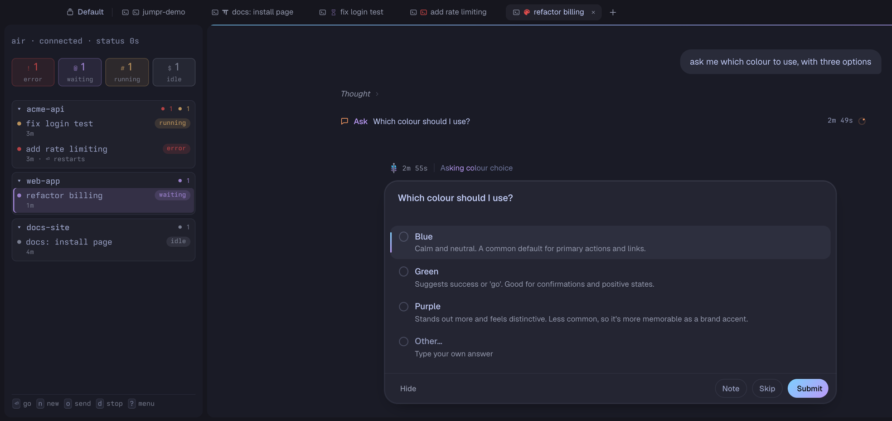
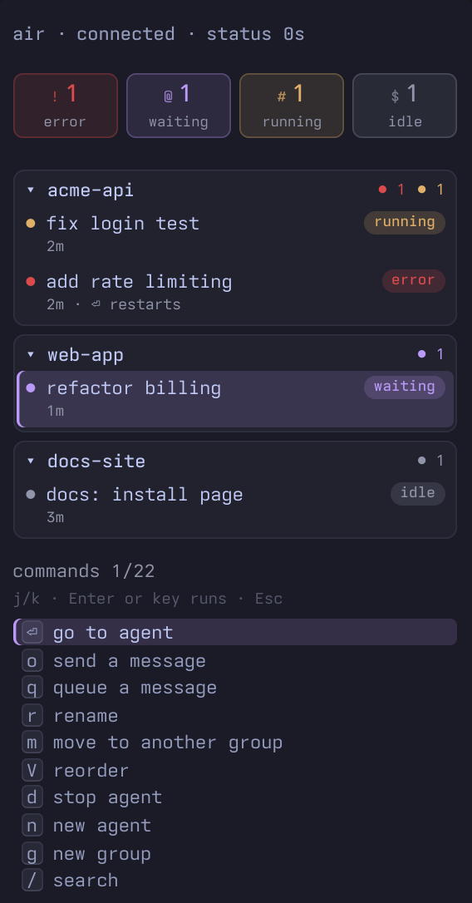
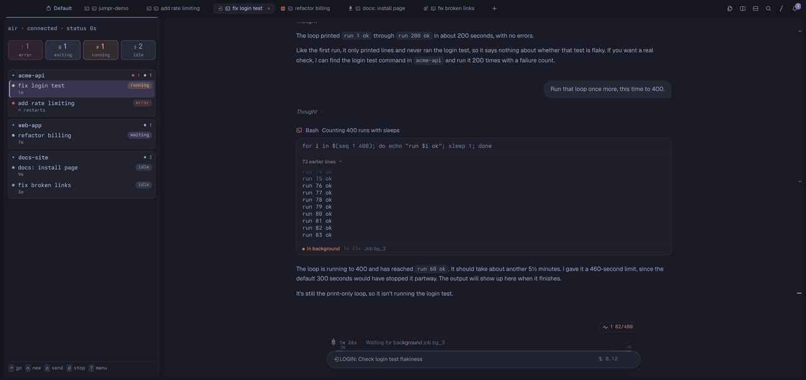
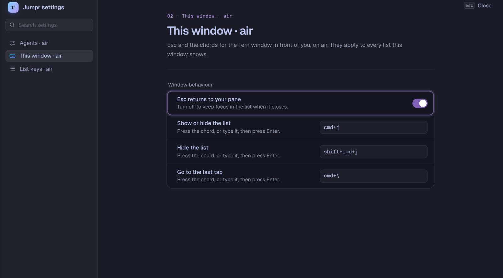
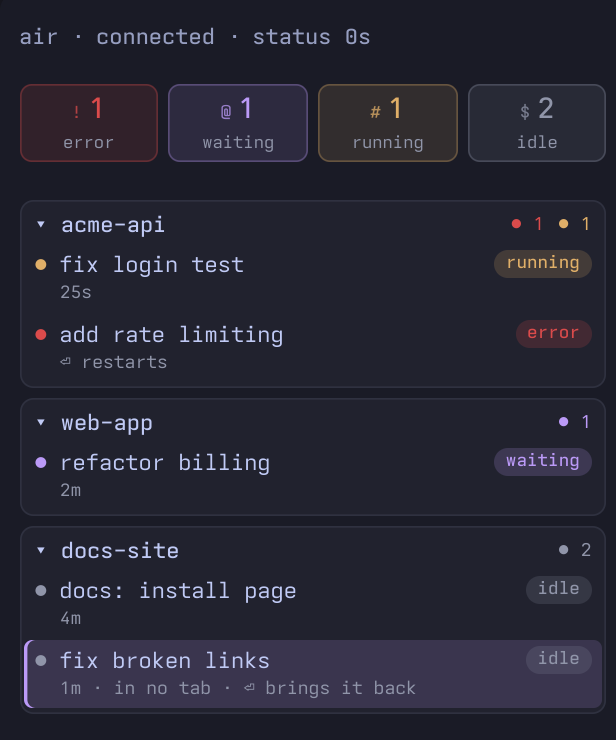

# Jumpr

A keyboard-driven list of your coding agents for [Tern](https://stencil.so/tern), grouped by project, one list per machine.



Agents sit in groups, one per project folder, and each row shows whether its agent is running, waiting for you, idle or in error.
Moving through the list brings each agent's tab to the front, so the live agent is the preview, and Enter takes you into it.
It works for agents on the machine in front of you and on remote machines Tern is attached to, one list per machine.
Start omp, Claude Code or any agent Tern's ACP chat runs, and change the default agent, the chords and the list's keys from the built-in settings page.

- [Requirements](#requirements)
- [Install](#install)
- [Getting started](#getting-started)
- [Keys](#keys)
- [Settings](#settings)
- [How it works](#how-it-works)
- [What it runs and writes](#what-it-runs-and-writes)
- [Uninstall](#uninstall)
- [Known limitations](#known-limitations)
- [Troubleshooting](#troubleshooting)
- [Development](#development)
- [Credits](#credits)
- [License](#license)

## Requirements

- Tern 0.9.18 or newer, on every machine that runs Jumpr: this version uses the ACP chat's `--resume`, `--continue` and `--sessions` flags and Tern's settings calls.
- `omp` on the login shell's `PATH` of every machine that runs omp agents.
- Any other agent is started through Tern's ACP chat, so the machine that runs agents needs the CLI that chat starts.
- `git` on every machine you install Jumpr on, since `tern plugin install` clones the repository with it.
- macOS or Linux; Windows is untested.

The default agent is omp; the settings page changes it to any agent Tern's ACP chat runs, such as `claude`, `codex` or `copilot`.

## Install

Run this in a terminal on each machine that needs it:

```sh
tern plugin install github.com/starkedev/jumpr
tern plugin list
```

`tern plugin list` should show `jumpr` as ready.

Jumpr has a host half and a window half (see [How it works](#how-it-works)), and each runs on a different machine.
Install it on every machine whose Tern windows you use, and on every machine that runs agents.
When your windows and your agents are on the same computer, that is one install.
To install on a remote host, run the command in a pane on that host.

To update, install again over the old copy, on each machine:

```sh
tern plugin install github.com/starkedev/jumpr --force
```

Tern has no separate update command; `--force` replaces the installed copy and reloads it.
[CHANGELOG.md](CHANGELOG.md) lists what changed in each version.

## Getting started

1. Open a Tern session on the machine whose agents you want in the list.
2. Press the jumpr key (⌘J on macOS, Ctrl+Alt+J on Linux and Windows) to show the list.
   That session becomes Jumpr's session for that machine, and every tab in it gets a copy of the list on its left.
3. Press `g` and give a project folder to make a group.
   The folder must already exist on that machine; a git repository's group is named after the repository.
4. Press `n` on the group to start an agent in that folder, in a new tab.

`n` starts the machine's default agent, which is omp until you change it.
To start something else, press `,` in the list to open the settings page and set the default agent (see [Settings](#settings)); any agent Tern's ACP chat runs can be the default.

Only agents started from Jumpr with `n` are listed.
Agents you start yourself in a plain tab are left alone; [How it works](#how-it-works) explains why.

## Keys

### The jumpr key

The jumpr key is ⌘J on macOS and Ctrl+Alt+J on Linux and Windows.
Pressed outside the list, it shows the list if it is hidden and focuses it.
Pressed in the list, it goes back to the pane you came from and hides the list.

| Key | Does | Palette command |
|---|---|---|
| ⌘J · Ctrl+Alt+J | Show and focus the list, or go back and hide it | Jumpr: toggle list |
| ⌘⇧J · Ctrl+Alt+Shift+J | Hide the list from anywhere | Jumpr: hide list |
| ⌘\\ · Ctrl+Alt+; | Jump to the tab you last worked in; press again to come back. Scrolling through the list doesn't count as working in a tab. The list's highlight follows to that tab's agent | Jumpr: last tab |
| | Focus the list | Jumpr: focus list |
| | Hide or show the list without moving focus | Jumpr: hide or show list |
| | Copy the paths of a diagnostics dump | Jumpr: diagnostics |

### Change the keys

The settings page is the easy way (see [Settings](#settings)): its "List keys" page changes the list's own keys, and its "This window" page takes a new chord for any of the three.
The three chords are ordinary Tern keybinds, so you can also set them by hand under `keybinds` in Tern's `settings.json` (`~/.config/tern/settings.json` on Linux), on each machine whose windows you use:

```json
"keybinds": {
  "ctrl+alt+k": "plugin.jumpr.toggle_focus"
}
```

Then run "Reload settings" from the palette; no restart is needed.
The three commands are `plugin.jumpr.toggle_focus` (the jumpr key), `plugin.jumpr.hide_list` and `plugin.jumpr.last_tab`.
Ctrl+J is a poor choice of your own: on Linux and Windows it is Tern's own join lines, and in a shell it is Enter.

### In the list

| Key | Does |
|---|---|
| `j` / `k`, `↓` / `↑` | Move the selection by one |
| `J` / `K` (Shift+j / Shift+k) | Move to the next or previous group's header; from an agent, `K` goes to its own group's header first |
| `G` / `End`, `Home` | Move to the last or first row |
| `Enter` | On an agent: focus its pane, or restart it, back into its own conversation, if it has exited. A parked agent (running in no tab) gets a tab of its own first. On a group: fold or unfold it |
| `Tab` | Fold or unfold a group |
| `h` / `l` | Fold or unfold the selected group |
| `n` | Start a new agent in the selected group |
| `g` | New group (asks for a folder first) |
| `r` | Rename the agent; the name also becomes its tab's name |
| `m` | Move the agent to another group |
| `V` | Pick the row up to reorder it: an agent within its group, or a group header among the groups. `j` / `k` move it, `Enter` or `V` drops it, `Esc` puts it back |
| `d` | Stop the agent, or delete the group (asks `y/n`) |
| `o` | Send a message to the agent now. On an exited agent, or one whose start failed, start it again first; the message is sent once it is idle. When its conversation has to be picked, the message is held and Enter opens the picker; it is sent once a conversation is picked and the chat is idle |
| `q` | Queue a message, sent once the agent is idle |
| `i` | Show where each row's status comes from |
| `/` | Search labels, folders and group names |
| `?` | Open the command menu |
| `,` | Open the settings page (see [Settings](#settings)) |

The command menu lists every key in the list with what it does on the selected row.
`j` / `k` or `↓` / `↑` move, `Enter` or the command's own key runs it, and `Esc` or `?` closes it.
Commands the selected row does not suit are dimmed.



### Filters

Filters show only the agents in the states you pick.
The keys run along the shifted number row in priority order, what needs you first:

| Key | Shows |
|---|---|
| `!` (Shift+1) | Error |
| `@` (Shift+2) | Waiting for you |
| `#` (Shift+3) | Running |
| `$` (Shift+4) | Idle |
| `0` | Everything |
| `1` `2` `3` `4` | Add error, waiting, running or idle to the filter, or drop it |

Pressing a filter key a second time clears it.
`! @ # $` always show one status only, even when several are on.
`1 2 3 4` combine them: `2` then `3` shows waiting and running agents together, and pressing a key again drops its status; dropping the last one clears the filter.
The count tiles at the top show the same symbols in the same order, error first: each tile shows its status key next to the count and the word under it (`@ 2` / waiting), and every tile whose status is in the filter is outlined.
Clicking a tile shows that status only, as its key does, and clicking the only outlined tile again clears the filter.
Option+click (alt+click) on a tile adds its status to the filter, or drops it when it is already on, as `1 2 3 4` do.
The head line names the filter in words, for example `filter @ waiting` or `filter @ waiting + # running`.

### Preview and Esc

When a move rests on a live agent for 120 ms, that agent's tab comes to the front.
Any other key in that pause cancels it.



Esc clears an open input, search or filter first.
With none open, it returns focus to the pane you were in before the list.
Esc never hides the list.
If `esc_mode` in `window.json` (in Jumpr's data folder) is `"B"`, Esc only cancels an open input, and the jumpr key goes back instead.
The settings page's "This window" page flips this (see [Settings](#settings)).

### Mouse

Click a group's header to fold or unfold it, and click an agent to select it, as if you had moved onto it.
Click a count tile to show that status only, as its key does, and Option+click (alt+click) it to add it to the filter or drop it.
Clicks only act in the list itself; while an input, a question, the group picker, the command menu or a reorder is open, they do nothing.

## Settings

Press `,` in the list, or run "Jumpr: settings" from the palette, and the settings page opens in a tab of its own.
`[` and `]` move between its three pages, `j` and `k` between a page's rows, Enter opens the focused row, and Esc closes the page and takes you back to the pane you were in.
These keys are fixed, so no key binding can lock you out of the page.
Each page names the machine its values belong to.



- **Agents** — the default agent `n` starts: pick a common one from the menu, or type any agent id Tern's ACP chat knows.
  This value belongs to the machine whose list you are looking at.
- **This window** — whether Esc returns to your pane, and the three global chords.
  Open a chord's row and press the chord, or type it as text such as `ctrl+alt+k`, then press Enter.
  A chord Tern or your system already takes never reaches the page, so type that one.
  These values belong to the window you opened the page in, so each window machine sets its own; with several windows open, only the window showing the settings page changes.
  A chord another action holds is refused, Reset puts the default back, and a change takes effect without a restart.
- **List keys** — every key the list uses, one row per action, shown as you type it (`j` and `J` are different keys).
  This value belongs to the machine whose list you are looking at.
  Enter on a row waits for your next key press: a taken or reserved key is refused with a reason.
  Reset on a changed row, or Backspace while it waits, puts that key's default back, and "Reset all keys" restores every default.
  The `?` menu, the legend and the hints follow a change at once.

A text box opens with its text selected, so typing replaces it; an arrow key places the caret to edit it instead.

The mouse works too: click a row to choose it, and click a control to change or pick a value.

## How it works

### Two halves

A Tern plugin can have two halves that run in different places, and Jumpr uses both.

- The host half runs on the machine that runs the agents.
  It holds the list, starts and stops agents, and draws the list you see.
- The window half runs on the machine showing the Tern window.
  It watches agent status, brings tabs to the front, owns the keys and the palette commands, and carries the list's requests to the host half.

That is why Jumpr is installed on both machines when they differ.
A window without its own install still shows a remote machine's list, but nothing in it works.
Every message between the halves carries a protocol version, so a machine running an older Jumpr is named in a banner instead of failing quietly.

### How agents get into the list

Pressing `n` on a group starts the machine's default agent in a new tab of Jumpr's session, in the group's folder.
An omp agent starts as:

```sh
omp --continue --session-dir ~/.omp/deck/<id>
```

Any other agent starts through Tern's ACP chat, as:

```sh
env JUMPR_ID=<id> tern acp <agent>
```

`<id>` is a random eight-character id Jumpr gives the agent.
Jumpr recognises its agents by that id — an omp agent carries it in its session folder under `~/.omp/deck/`, and any other agent carries it in the `JUMPR_ID` on its command — so agents started any other way are never listed.
Restarting an exited agent with `Enter` brings back its own conversation: an omp agent resumes from its session folder, and any other agent resumes by conversation id where that can be proven, continues the last conversation of its kind in that folder when that is safe, and opens Tern's conversation picker otherwise (see [Known limitations](#known-limitations)).

### Status

Status comes from Tern's own agent tracking: running, waiting for you, idle, error or stopped.
Each row shows its status, how long it has been in it, its folder when that is not the group's, and what is waiting on it.
Press `i` to see where each row's status comes from.
An agent you parked in Tern keeps running, and its row keeps its status and says `in no tab`.
Moving onto it leaves your tabs as they are; `Enter` brings it back into a tab of its own, with its copy of the list, and goes to it.



## What it runs and writes

It runs:

- `omp --continue --session-dir ~/.omp/deck/<id>`, in a terminal tab, to start or restart an omp agent.
- `env JUMPR_ID=<id> tern acp <agent>`, in a terminal tab, to start or restart any other agent through Tern's ACP chat.
  A restart adds `--resume <session id>`, `--continue` or `--sessions` to that command.
  While an agent runs, a second start of it (from another window, or by hand) runs a line saying so instead, and closes: two processes never share one agent.
- `grep -q -z -x JUMPR_ID=<id> /proc/<pid>/environ`, on Linux, to prove which conversation belongs to which Claude Code agent before a restart.
  The grep only answers yes or no; a process's environment is never read into the plugin.
  The conversation id it proves comes from Claude Code's own session files, `~/.claude/sessions/<pid>.json`, which Jumpr reads for this lookup.
- `git rev-parse --git-common-dir`, to name a group after its repository.
- `tern --version`, for the diagnostics dump.

It types only the text you enter for `o` and `q`, into that agent's pane.

It writes, in Jumpr's data folder on each machine (`<state>/plugin-data/jumpr/`; `~/.local/state/tern/plugin-data/jumpr/` on Linux, `~/Library/Application Support/Tern/plugin-data/jumpr/` on macOS):

- `jumpr.v1` in `kv.json` on the agents' machine: groups, labels, folds, the agent records (each with the last title its conversation showed), the queued messages and the settings (the default agent and the list keys).
- `window.json` on the window's machine: which window leads, and the window settings.
  A chord change goes into Tern's own `settings.json` keybinds, not into Jumpr's files.
- Diagnostics dumps (`diag-window-<ms>.json` and `diag-host-<ms>.json`), only when you run "Jumpr: diagnostics".

Each omp agent's conversation lives in `~/.omp/deck/<id>`, which omp writes and Jumpr never deletes, even when you stop the agent with `d`.
Any other agent's conversation lives in its CLI's own files, which Jumpr reads only for the restart lookup above.
Jumpr makes no network requests of its own.

## Uninstall

On a machine, either turn Jumpr off by adding `"jumpr"` to `plugins_disabled` in Tern's `settings.json`, or remove it:

```sh
tern plugin remove jumpr
```

Agents keep running as ordinary tabs; only the list goes away.
Jumpr's data folder is kept, so a reinstall finds your groups and agents again.
Delete that folder by hand to start fresh.

## Known limitations

- Restarting an exited agent is exact, back into its own conversation, for omp always and for Claude Code on Linux.
  Checked end to end on Linux: two Claude agents in one folder were closed and restarted, and each came back into its own conversation, with no picker.
- Without that lookup — on macOS, or for another agent — Enter on an exited agent continues the last conversation of its kind in that folder when Jumpr can prove that is safe, and opens Tern's conversation picker otherwise.
- Only Claude Code has been tried through the ACP path; `codex`, `copilot` and custom agent ids take the same route but are unobserved.
- Windows is untested; macOS and Linux are the tested platforms.
- A restart of Tern's session daemon on an agents' machine is untested: groups and records are stored, but how agents rejoin the list afterwards has not been checked.
  Tern may bring a chat back by itself while its row still reads exited, and pressing Enter on that row before the list catches up is untested.
- One window per machine is recommended.
  Several windows elect a leader between them, and that path is only lightly tested.
  If `window.json` cannot be written, every window acts alone, so keep to one window.
- One list per machine: the first session you show the list in is Jumpr's session there; showing it in another session moves it.

## Troubleshooting

- **The jumpr key does nothing.**
  Check that your window manager or desktop is not taking the chord, or give it one of your own under [Change the keys](#change-the-keys).
- **A remote machine's list shows, but keys and clicks do nothing.**
  The window half is missing on the machine showing the window: install Jumpr there too.
- **A banner says "update Jumpr on …".**
  The two halves run different versions: run the update command on the machine the banner names.
- **An agent you started yourself is not in the list.**
  Only agents started with `n` are listed (see [How agents get into the list](#how-agents-get-into-the-list)).
- **Enter on an exited agent opened a picker instead of its conversation.**
  Without a proven conversation id, Jumpr continues a conversation only when it knows that one is this agent's; pick the right conversation from Tern's picker (see [Known limitations](#known-limitations)).
- **Something else looks wrong.**
  Run "Jumpr: diagnostics" from the palette.
  It writes a window dump and a host dump to Jumpr's data folder and copies their paths, which you can attach to an issue.
  Tern's own `tern plugin list` shows whether the plugin loaded, and its error if it did not.

## Development

Link a checkout instead of installing it, so Tern reloads the plugin when a file changes:

```sh
git clone https://github.com/starkedev/jumpr
tern plugin link ./jumpr
```

Run `scripts/check.sh` before every commit.
It runs stylua, the unit tests, a strict `luau-lsp` type check and the design-rule checks.
It needs `stylua`, `luau`, `luau-lsp` and `rg` on `PATH`.
The first run also needs `tern`, to write `tern.d.luau` with `tern plugin types .`.

Install the tools from their release pages:

- `stylua`: https://github.com/JohnnyMorganz/StyLua/releases
- `luau`: https://github.com/luau-lang/luau/releases
- `luau-lsp`: https://github.com/JohnnyMorganz/luau-lsp/releases
- `rg` (ripgrep): https://github.com/BurntSushi/ripgrep/releases

`host.luau` and `lib/host/` are the host half, `window.luau` and `lib/window/` the window half, and `lib/shared/` the message shapes, status rules and agent identity both halves use.
The unit suites in `test/` run under plain `luau`.

Bug reports and pull requests are welcome in [GitHub issues](https://github.com/starkedev/jumpr/issues).

## Credits

Jumpr borrows from [tern-agent-nav](https://github.com/Arcadia822/tern-agent-nav) by Arcadia (MIT): the spinner title helpers and the order of the status colours.
See [NOTICE](NOTICE) for the details and its licence.
Jumpr's key layout and workflow are inspired by [agent-deck](https://github.com/asheshgoplani/agent-deck) (MIT); no code is copied from it.

## License

[MIT](LICENSE)
