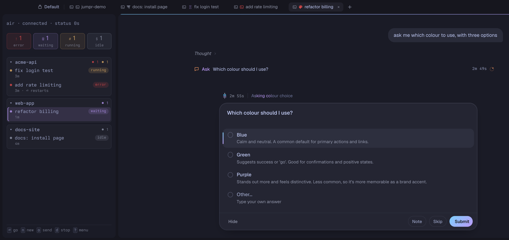
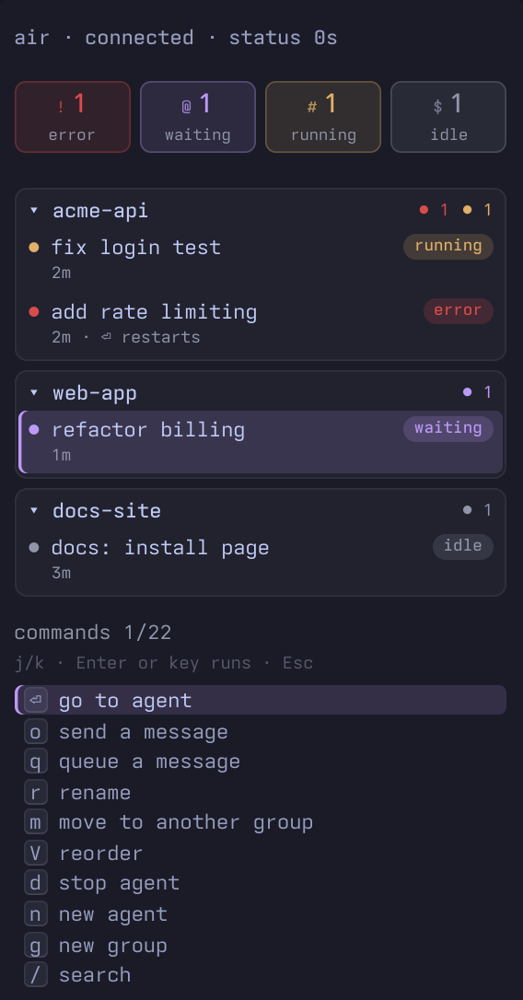

# Jumpr

A keyboard-driven list of your [omp](https://github.com/can1357/oh-my-pi) agents for [Tern](https://stencil.so/tern), grouped by project, one list per machine.



Agents sit in groups, one per project folder, and each row shows whether its agent is running, waiting for you, idle or in error.
Moving through the list brings each agent's tab to the front, so the live agent is the preview, and Enter takes you into it.
It works for agents on the machine in front of you and on remote machines Tern is attached to, one list per machine.

- [Requirements](#requirements)
- [Install](#install)
- [Getting started](#getting-started)
- [Keys](#keys)
- [How it works](#how-it-works)
- [What it runs and writes](#what-it-runs-and-writes)
- [Uninstall](#uninstall)
- [Known limitations](#known-limitations)
- [Troubleshooting](#troubleshooting)
- [Development](#development)
- [Credits](#credits)
- [License](#license)

## Requirements

- Tern 0.9.10 or newer (tested on 0.9.10 and 0.9.11).
- omp on every machine that runs agents, on the login shell's `PATH`.
- `git` on every machine you install Jumpr on, since `tern plugin install` clones the repository with it.
- macOS or Linux; Windows is untested.

Jumpr lists omp agents only; Claude Code and other agents are not supported yet.

## Install

Run this in a terminal on each machine that needs it:

```sh
tern plugin install github.com/starkedev/jumpr
tern plugin list
```

`tern plugin list` should show `jumpr` as ready.

Jumpr has a host half and a window half (see [How it works](#how-it-works)), and each runs on a different machine.
Install it on every machine whose Tern windows you use, and on every machine that runs agents.
When your windows and your agents are on the same computer, that is one install.
To install on a remote host, run the command in a pane on that host.

On Linux and Windows, add the two keybinds under [The jumpr key](#the-jumpr-key) too, or Super+J does nothing.

To update, install again over the old copy, on each machine:

```sh
tern plugin install github.com/starkedev/jumpr --force
```

Tern has no separate update command; `--force` replaces the installed copy and reloads it.
[CHANGELOG.md](CHANGELOG.md) lists what changed in each version.

## Getting started

1. Open a Tern session on the machine whose agents you want in the list.
2. Press the jumpr key (`cmd+j`: ⌘J on macOS, Super+J on Linux and Windows) to show the list.
   That session becomes Jumpr's session for that machine, and every tab in it gets a copy of the list on its left.
3. Press `g` and give a project folder to make a group.
   The folder must already exist on that machine; a git repository's group is named after the repository.
4. Press `n` on the group to start an agent in that folder, in a new tab.

Only agents started from Jumpr with `n` are listed.
Agents you start yourself in a plain tab are left alone; [How it works](#how-it-works) explains why.

## Keys

### The jumpr key

The jumpr key is `cmd+j`: ⌘J on macOS, Super+J on Linux and Windows.
Pressed outside the list, it shows the list if it is hidden and focuses it.
Pressed in the list, it goes back to the pane you came from and hides the list.

| Key | Does | Palette command |
|---|---|---|
| `cmd+j` (⌘J, Super+J) | Show and focus the list, or go back and hide it | Jumpr: toggle list |
| `cmd+shift+j` (⌘⇧J, Super+Shift+J) | Hide the list from anywhere | Jumpr: hide list |
| `cmd+\` (⌘\\, Super+\\) | Jump to the tab you were in before this one; press again to come back. The list's highlight follows to that tab's agent | Jumpr: last tab |
| | Focus the list | Jumpr: focus list |
| | Hide or show the list without moving focus | Jumpr: hide or show list |
| | Copy the paths of a diagnostics dump | Jumpr: diagnostics |

**Linux and Windows:** Tern's PC key preset already binds Win+J to `editor.join_lines`, and a preset bind wins over a plugin's, so Super+J does nothing until you add a user keybind.
Add these two lines to the `keybinds` in Tern's `settings.json` on each machine whose windows you use, then run "Reload settings" from the palette:

```json
"cmd+j": "plugin.jumpr.toggle_focus",
"cmd+shift+j": "plugin.jumpr.hide_list"
```

Your own keybinds win over the preset.
On Linux, a tiling window manager (Hyprland, Sway, i3 and others) often binds Super+J and Super+Shift+J itself, so the keys never reach Tern.
Free them in the window manager's config, or bind other chords to the same two commands.

### In the list

| Key | Does |
|---|---|
| `j` / `k`, `↓` / `↑` | Move the selection by one |
| `J` / `K` (Shift+j / Shift+k) | Move to the next or previous group's header; from an agent, `K` goes to its own group's header first |
| `G` / `End`, `Home` | Move to the last or first row |
| `Enter` | On an agent: focus its pane, or restart it in its own session if it has exited. On a group: fold or unfold it |
| `Tab` | Fold or unfold a group |
| `h` / `l` | Fold or unfold the selected group |
| `n` | Start a new agent in the selected group |
| `g` | New group (asks for a folder first) |
| `r` | Rename the agent; the name also becomes its tab's name |
| `m` | Move the agent to another group |
| `V` | Pick the row up to reorder it: an agent within its group, or a group header among the groups. `j` / `k` move it, `Enter` or `V` drops it, `Esc` puts it back |
| `d` | Stop the agent, or delete the group (asks `y/n`) |
| `o` | Send a message to the agent now |
| `q` | Queue a message, sent once the agent is idle |
| `i` | Show where each row's status comes from |
| `/` | Search labels, folders and group names |
| `?` | Open the command menu |

The command menu lists every key in the list with what it does on the selected row.
`j` / `k` or `↓` / `↑` move, `Enter` or the command's own key runs it, and `Esc` or `?` closes it.
Commands the selected row does not suit are dimmed.



### Filters

Filters show only the agents in one state.
The keys run along the shifted number row in priority order, what needs you first:

| Key | Shows |
|---|---|
| `!` (Shift+1) | Error |
| `@` (Shift+2) | Waiting for you |
| `#` (Shift+3) | Running |
| `$` (Shift+4) | Idle |
| `0` | Everything |

Pressing a filter key a second time clears it.
The count tiles at the top show the same symbols in the same order, error first: each tile shows its status key next to the count and the word under it (`@ 2` / waiting), and the tile whose filter is on is outlined.
The head line names an active filter in words, for example `filter @ waiting`.

### Preview and Esc

When a move rests on a live agent for 120 ms, that agent's tab comes to the front.
Any other key in that pause cancels it.

Esc clears an open input, search or filter first.
With none open, it returns focus to the pane you were in before the list.
Esc never hides the list.
If `esc_mode` in `window.json` (in Jumpr's data folder) is `"B"`, Esc only cancels an open input, and the jumpr key goes back instead.

### Mouse

Click a group's header to fold or unfold it, and click an agent to select it, as if you had moved onto it.
Clicks only act in the list itself; while an input, a question, the group picker, the command menu or a reorder is open, they do nothing.

## How it works

### Two halves

A Tern plugin can have two halves that run in different places, and Jumpr uses both.

- The host half runs on the machine that runs the agents.
  It holds the list, starts and stops agents, and draws the list you see.
- The window half runs on the machine showing the Tern window.
  It watches agent status, brings tabs to the front, owns the keys and the palette commands, and carries the list's requests to the host half.

That is why Jumpr is installed on both machines when they differ.
A window without its own install still shows a remote machine's list, but nothing in it works.
Every message between the halves carries a protocol version, so a machine running an older Jumpr is named in a banner instead of failing quietly.

### How agents get into the list

Pressing `n` on a group starts omp in a new tab of Jumpr's session, in the group's folder, as:

```sh
omp --continue --session-dir ~/.omp/deck/<id>
```

`<id>` is a random eight-character id Jumpr gives the agent, and `~/.omp/deck/` is the folder that holds Jumpr's omp sessions.
Jumpr recognises its agents by that session folder, so agents started any other way are never listed, and restarting an exited agent with `Enter` resumes its conversation.

### Status

Status comes from Tern's own agent tracking: running, waiting for you, idle, error or stopped.
Each row shows its status, how long it has been in it, its folder when that is not the group's, and what is waiting on it.
Press `i` to see where each row's status comes from.

## What it runs and writes

It runs:

- `omp --continue --session-dir ~/.omp/deck/<id>`, in a terminal tab, to start or restart an agent.
- `git rev-parse --git-common-dir`, to name a group after its repository.
- `tern --version`, for the diagnostics dump.

It types only the text you enter for `o` and `q`, into that agent's pane.

It writes, in Jumpr's data folder on each machine (`<state>/plugin-data/jumpr/`; `~/.local/state/tern/plugin-data/jumpr/` on Linux, `~/Library/Application Support/Tern/plugin-data/jumpr/` on macOS):

- `jumpr.v1` in `kv.json` on the agents' machine: groups, labels, folds, the agent records and the queued messages.
- `window.json` on the window's machine: which window leads, and the window settings.
- Diagnostics dumps (`diag-window-<ms>.json` and `diag-host-<ms>.json`), only when you run "Jumpr: diagnostics".

Each agent's conversation lives in `~/.omp/deck/<id>`, which omp writes and Jumpr never deletes, even when you stop the agent with `d`.
Jumpr makes no network requests of its own.

## Uninstall

On a machine, either turn Jumpr off by adding `"jumpr"` to `plugins_disabled` in Tern's `settings.json`, or remove it:

```sh
tern plugin remove jumpr
```

Agents keep running as ordinary omp tabs; only the list goes away.
Jumpr's data folder is kept, so a reinstall finds your groups and agents again.
Delete that folder by hand to start fresh.

## Known limitations

- omp only: Claude Code and other agents are not listed yet.
- Windows is untested; macOS and Linux are the tested platforms.
- A restart of Tern's session daemon on an agents' machine is untested: groups and records are stored, but how agents rejoin the list afterwards has not been checked.
- One window per machine is recommended.
  Several windows elect a leader between them, and that path is only lightly tested.
  If `window.json` cannot be written, every window acts alone, so keep to one window.
- One list per machine: the first session you show the list in is Jumpr's session there; showing it in another session moves it.

## Troubleshooting

- **Super+J does nothing on Linux or Windows.**
  Add the user keybinds under [The jumpr key](#the-jumpr-key), and check that your window manager is not taking the chord.
- **A remote machine's list shows, but keys and clicks do nothing.**
  The window half is missing on the machine showing the window: install Jumpr there too.
- **A banner says "update Jumpr on …".**
  The two halves run different versions: run the update command on the machine the banner names.
- **An agent you started yourself is not in the list.**
  Only agents started with `n` are listed (see [How agents get into the list](#how-agents-get-into-the-list)).
- **Something else looks wrong.**
  Run "Jumpr: diagnostics" from the palette.
  It writes a window dump and a host dump to Jumpr's data folder and copies their paths, which you can attach to an issue.
  Tern's own `tern plugin list` shows whether the plugin loaded, and its error if it did not.

## Development

Link a checkout instead of installing it, so Tern reloads the plugin when a file changes:

```sh
git clone https://github.com/starkedev/jumpr
tern plugin link ./jumpr
```

Run `scripts/check.sh` before every commit.
It runs stylua, the unit tests, a strict `luau-lsp` type check and the design-rule checks.
It needs `stylua`, `luau`, `luau-lsp` and `rg` on `PATH`.
The first run also needs `tern`, to write `tern.d.luau` with `tern plugin types .`.

Install the tools from their release pages:

- `stylua`: https://github.com/JohnnyMorganz/StyLua/releases
- `luau`: https://github.com/luau-lang/luau/releases
- `luau-lsp`: https://github.com/JohnnyMorganz/luau-lsp/releases
- `rg` (ripgrep): https://github.com/BurntSushi/ripgrep/releases

`host.luau` and `lib/host/` are the host half, `window.luau` and `lib/window/` the window half, and `lib/shared/` the message shapes, status rules and agent identity both halves use.
The unit suites in `test/` run under plain `luau`.

Bug reports and pull requests are welcome in [GitHub issues](https://github.com/starkedev/jumpr/issues).

## Credits

Jumpr borrows from [tern-agent-nav](https://github.com/Arcadia822/tern-agent-nav) by Arcadia (MIT): the spinner title helpers and the order of the status colours.
See [NOTICE](NOTICE) for the details and its licence.
Jumpr's key layout and workflow are inspired by [agent-deck](https://github.com/asheshgoplani/agent-deck) (MIT); no code is copied from it.

## License

[MIT](LICENSE)
